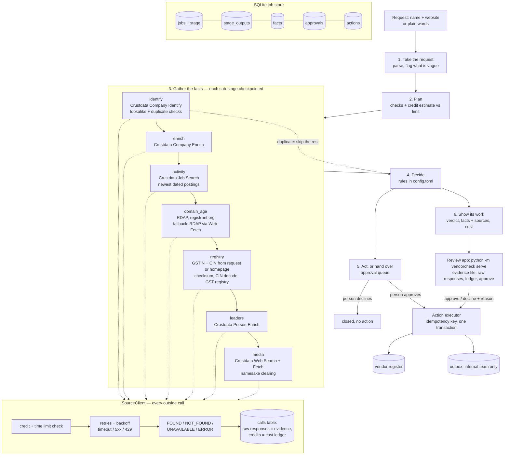

# Architecture

## Where things sit

| Concern | Where | How |
|---|---|---|
| Data calls | `vendorcheck/crustdata.py`, `SourceClient.call` | All calls go through one wrapper |
| Retries | `SourceClient.call` | Timeouts, 5xx and 429 retried with backoff (429 waits for `X-RateLimit-Reset`) |
| Silence ≠ answer | `SourceClient.call` → `rules.py` | `UNAVAILABLE` / `ERROR` become *cannot verify*, never a red flag |
| Cost ledger | `calls` table (a row is written IN_FLIGHT before each request; a kill leaves it INTERRUPTED with its estimated cost) | `x-credits-used` header per call; `python -m vendorcheck ledger JOB` |
| Limits | `SourceClient._over_budget` | Calls past the credit/time limit are skipped and reported |
| Evidence | `vendorcheck/evidence.py` | API facts = JSON path into the stored response; web facts = a passage that must appear verbatim in the fetched page |
| Resume after kill | `Pipeline.run`, `Store.save_stage` | Stage output + stage advance in one transaction; completed calls are cached per job |
| Approvals | `approvals` table, `actions.py` | Clearing and rejecting both wait for a person |
| Exactly once | `actions` table (idempotency key `JOB:decision`; the pending check is repeated inside the transaction) | Approval, action, register entry and notification commit together |
| Rules and output fields | `config.toml` | Thresholds, limits and output fields change without code changes |
| Logs | `data/logs/JOB.jsonl` (`Store.log_event`) | Every stage start/finish, call (status, attempts, credits), cached replay and action |
| Client vendor list | `vendor_register` (`import-vendors`) | Keyed by Crustdata ID, website, `gstin:`, `name:`; duplicates are held before paying for the rest |
| Overrides | `approvals.override_reason` | Choosing another action than recommended needs a written reason |
| Monitoring | `rescreen` (`batch.rescreen`, `Pipeline._carry_over`) | Re-runs news + GST for approved vendors; identity/profile carried over; one job per vendor per day (idempotent); alert once via outbox |
| Retention | `Store.purge_raw_responses` | Raw responses of closed jobs deleted after `retention_days`; facts and quotes kept |

## Exactly once: the outbox pattern

An approval writes four rows in ONE SQLite transaction: the approval decision, the action row
(primary key = idempotency key `JOB:decision`, one decision per job), the vendor-register entry and the outbox message.
Either all four commit or none do. A kill before COMMIT leaves nothing, so the person can approve
again; a kill after COMMIT makes a repeat approval a no-op ("already done"). Sending a message
outside the database (email, Slack) would be a separate worker reading the outbox and marking each
row sent, so a crash between "sent" and "marked" re-sends at most once to an idempotent receiver.

Batch rows get job IDs from the batch file's hash and the row number, so re-running a batch after a
crash resumes unfinished rows instead of creating new jobs (which would also look like duplicates).

## Scaling notes (for the design question)

- **100× volume:** the stages are already independent and checkpointed; put jobs on a queue
  (one row per job is already the unit of work) and run N workers. Cache Identify/Enrich
  results across jobs by company ID with a freshness window, and share one rate limiter per
  Crustdata endpoint across workers.
- **A second client:** add `client_id` to jobs, approvals and the vendor register, and load a
  `config.toml` per client (their own thresholds, limits and approvers).
