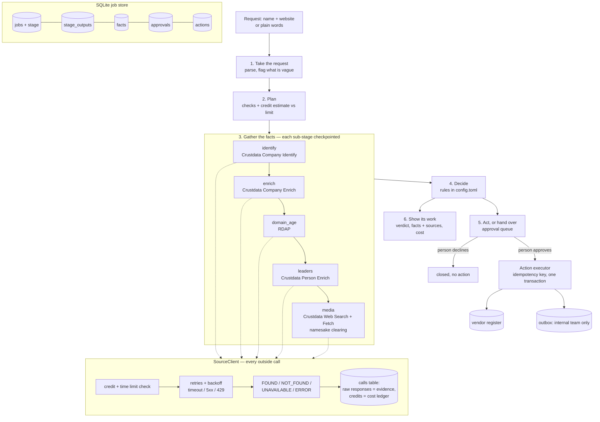

# Architecture

## Where things sit

| Concern | Where | How |
|---|---|---|
| Data calls | `vendorcheck/crustdata.py`, `SourceClient.call` | All calls go through one wrapper |
| Retries | `SourceClient.call` | Timeouts, 5xx and 429 retried with backoff (429 waits for `X-RateLimit-Reset`) |
| Silence ≠ answer | `SourceClient.call` → `rules.py` | `UNAVAILABLE` / `ERROR` become *cannot verify*, never a red flag |
| Cost ledger | `calls` table | `x-credits-used` header per call; `python -m vendorcheck ledger JOB` |
| Limits | `SourceClient._over_budget` | Calls past the credit/time limit are skipped and reported |
| Evidence | `vendorcheck/evidence.py` | API facts = JSON path into the stored response; web facts = a passage that must appear verbatim in the fetched page |
| Resume after kill | `Pipeline.run`, `Store.save_stage` | Stage output + stage advance in one transaction; completed calls are cached per job |
| Approvals | `approvals` table, `actions.py` | Clearing and rejecting both wait for a person |
| Exactly once | `actions` table (idempotency key) | Approval, action, register entry and notification commit together |
| Rules and output fields | `config.toml` | Thresholds, limits and output fields change without code changes |

## Scaling notes (for the design question)

- **100× volume:** the stages are already independent and checkpointed; put jobs on a queue
  (one row per job is already the unit of work) and run N workers. Cache Identify/Enrich
  results across jobs by company ID with a freshness window, and share one rate limiter per
  Crustdata endpoint across workers.
- **A second client:** add `client_id` to jobs, approvals and the vendor register, and load a
  `config.toml` per client (their own thresholds, limits and approvers).
