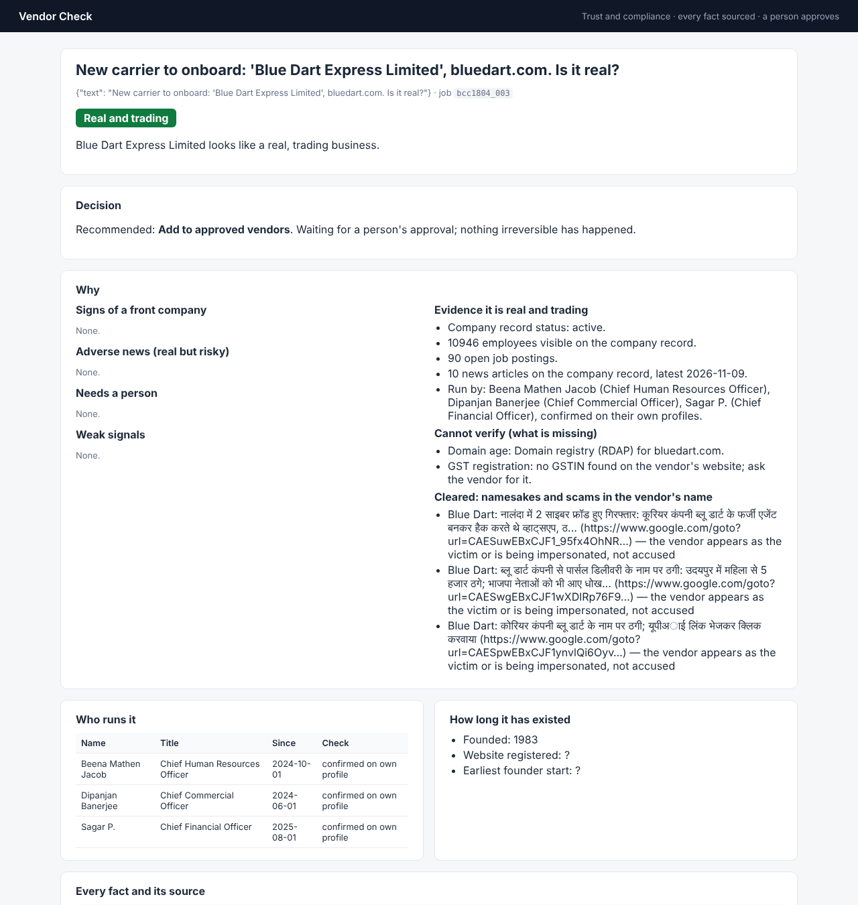
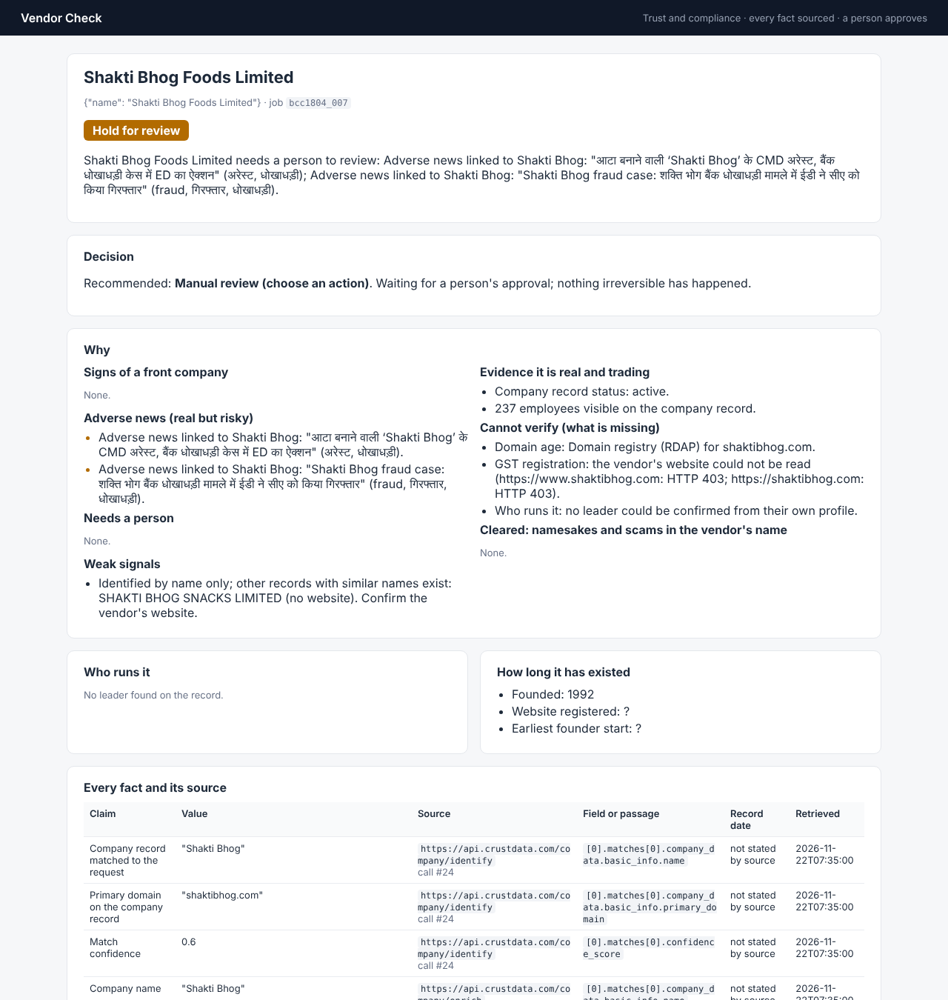

# Vendor Check — Trust and compliance (ContextCon 05)

An agent that does the whole job of a vendor verification firm: given a new vendor's name and
website, it decides whether the vendor is a **real, trading business**, says **who runs it**,
**how long it has existed** and **anything that looks off**, then screens the people who run it
against the news and **clears innocent namesakes** (themes 5.1 Vendor Check + 5.2 Adverse Media Screen).

**Quick look:** [sample output](docs/sample_output.txt) (mock data) · [review app](#review-app-the-compliance-teams-screen) ·
[finance](FINANCE.md) · [demo playbook](DEMO.md) · [architecture](ARCHITECTURE.md) · [build notes](NOTES.md)

## The job, and who pays for it today

Before money moves to a new vendor, a compliance team or an outside verification and screening
firm checks that the business is who it says it is. Our client, a mid-size Indian 3PL, onboards
carriers, warehouse operators and suppliers every week and pays for each check. A front company
can carry genuine papers, records share no common key, and a slow source looks like a missing
one, so the check is slow, manual and error-prone.

## Input

```bash
python -m vendorcheck run --name "Acme Freight Pvt Ltd" --website acmefreight.in
python -m vendorcheck run --text "Here is a new vendor: 'Acme Freight', acmefreight.in. Is it real?"
python -m vendorcheck run --name "Acme Freight Pvt Ltd" --website acmefreight.in --gstin 27AAACA1234A1ZK   # example format; use the vendor's real GSTIN
python -m vendorcheck batch requests.json     # JSON list or CSV (name, website, text, gstin); restart-safe
python -m vendorcheck eval tests/cases.json   # batch + pass / safe miss / wrong against each row's "expected"
                                              # ("!REAL_AND_TRADING" = a front must never be approved)
```

## Finished result

One verdict, with every fact linked to its source: the exact field or verbatim passage, the record's own
date where the source gives one (article date, domain registration, GST registration), and when it was retrieved:

| Verdict | Meaning | Recommended action (a person approves) |
|---|---|---|
| `REAL_AND_TRADING` | Identity resolved, someone confirmed running it, evidence it operates, no strong red flag | add to approved vendors |
| `FRONT_SUSPECTED` | ≥ 2 independent strong red flags, each with a source | reject vendor |
| `HOLD_FOR_REVIEW` | One strong red flag, adverse news linked to the vendor, a duplicate, or an ambiguous identity | manual review |
| `CANNOT_VERIFY` | A key question has no source (no record, timeout, budget). The output names what is missing | manual review |

The result also lists: who runs it (confirmed on their own profile or not), founding year and
domain registration date, trading evidence, red flags, namesakes cleared, what could not be
verified, every fact with its source, and the cost of the run.

## Pass mark

- Honest firms and innocent namesakes pass; fronts are caught **with evidence**.
- Every claim has a source; no fact comes from model memory.
- A source that times out is never read as "does not exist": it becomes *cannot verify*.
- Clearing **and rejecting** a vendor both wait for a person's approval, and happen exactly once.
- A run killed at any moment resumes where it stopped. A completed call is never paid again; a call killed
  while in flight stays in the ledger as `INTERRUPTED` with its estimated cost, so the cost record is honest.
- Each run stays inside its credit and time limit (`config.toml`).

## Data sources

| Source | Used for | Cost |
|---|---|---|
| Crustdata `POST /company/identify` | Resolve the domain or name to one company, with a confidence score | free |
| Crustdata `POST /company/enrich` | Status, founding year, headcount, HQ, hiring, news, founders/CXOs with their own employment history | 2 credits |
| Crustdata `POST /person/enrich` | Fallback only: a leader whose employment history was missing | 1+ credit per person |
| Crustdata `POST /web/search/live` (news, IN) | Adverse news: ONE combined search for the company and its leaders (English and Hindi terms) | 1 credit |
| Crustdata `POST /web/enrich/live` | Read an article that names a leader, to link or clear a namesake; the passage is stored | 1 credit per article (max 4) |
| Crustdata `POST /web/enrich/live` (vendor homepage) | GSTIN printed on the vendor's own website, kept as a verbatim passage | 1 credit |
| GST registry via Cashfree Secure ID (`/verification/gstin`, optional) | GST status, legal and trade name, registration date for the GSTIN | per provider plan |
| RDAP (`rdap.org`) | Domain registration date, independent of the company's own claims | free |

## Review app (the compliance team's screen)

```bash
python -m vendorcheck serve          # http://127.0.0.1:8765
```

Start a check (name, website, optional GSTIN), read the evidence file (verdict, the reasons behind
it, who runs it, every fact with its field or passage, record date and retrieval time), open the stored
raw response behind any API fact, see the cost ledger and event log, and approve or decline. Approving
twice does nothing the second time. Killing the server mid-check and starting it again resumes the
check. `python -m vendorcheck report JOB --html` writes the same evidence file as a standalone page.

## Monitoring approved vendors

```bash
python -m vendorcheck rescreen       # e.g. monthly, from cron
```
Every vendor approved through the service is checked again: the GST registry and the news (company and
leaders) are re-run; who the company is, its profile and leaders are carried over with their original
sources, so a re-screen costs about 1–2 credits instead of 4–8. No change: the job closes quietly. Anything
else (new adverse news, cancelled GST) goes to a person with an alert in the outbox, exactly once; the
person can reject the vendor, which updates the register.

## Hard cases (from the brief) and how each is handled

| Case | What the service does | Test |
|---|---|---|
| Lookalike name: real firm's name, different website | Identify by the website finds nothing, by name finds the real firm on another domain: **strong red flag "Lookalike"**, and the real firm's records are never used for this vendor | `TestLookalike`, `TestRealIdentifyByName` |
| Name only (no website) | Never auto-approved: at best **hold**, "confirm the vendor's website"; close-but-different names are **cannot verify**. Identify-by-name pads its answer with unrelated firms (seen live), so candidates are ranked by name match | `test_name_only_partial_match_cannot_verify` |
| Unknown vendor | **Cannot verify**, never accused | `test_unknown_vendor_is_not_accused` |
| Duplicate | Same website or Crustdata ID already in the vendor register or an open job: **held**, rest of the check skipped (saves credits) | `test_duplicate_vendor_is_held`, batch test |
| Source timeout / budget | **Cannot verify** with the reason; never a red flag | `test_timeout_is_cannot_verify_not_front` |
| Namesake in the news | Cleared (marked *weak*: based on absence) unless the article names the vendor (brand name, legal name or website) |
| Malformed input ("N/A" website, free text) | A bad website is "no website"; a name read from free text never becomes an accusation | `test_namesake_is_cleared` |
| Vendor is the victim ("fraudsters posing as …") | Not adverse | `test_vendor_as_victim_is_not_adverse` |
| Fake or cancelled GSTIN | Check-digit failure or non-active registry status: **strong red flag** | `TestRegistry` |

| Real data: Blue Dart (real, impersonation scams recognised) | Real data: Shakti Bhog (CMD arrested: held) |
|---|---|
|  |  |

**On real data:** `python scripts/replay_live.py` runs `tests/cases.json` on real Crustdata answers recorded on
22 Nov 2026 (Delhivery, Blue Dart, Shakti Bhog, a lookalike, a duplicate, an unknown vendor, an ambiguous shell
name): **8/8 pass, 0 wrong answers**. It is part of the test suite.

A wrong answer counts against us more than *cannot verify*, so every rule falls back to
*cannot verify* or *hold* when the evidence is incomplete.

## Approvals (human in the loop)

```bash
python -m vendorcheck approvals                          # what is waiting
python -m vendorcheck approve JOB --by "Your Name"       # run the recommended action
python -m vendorcheck approve JOB --by "Your Name" --action reject_vendor
python -m vendorcheck decline JOB --by "Your Name"
```

Agents stay in the room: notifications go to an internal `outbox` table for the team, never to
the vendor or anyone outside. Only people in `[approvals] approvers` may decide (when set); two people
deciding at once cannot both act; the review app refuses forms that did not come from itself.

## Ethics: personal data, approvals, explanations

- **A person decides every irreversible step.** Clearing *and* rejecting a vendor both wait for a named
  approver. The service only recommends. Overruling it is allowed, but needs a written reason
  (`--reason`), stored with the decision and the action.
- **Namesakes are protected.** An article counts against a director only if it also names the vendor.
  A clearance based on the vendor's name being absent is labelled *weak*, and a person confirms it. A page
  we could not read (paywall, bot check, other language) is *cannot verify*, never a clearance or a link.
  Adverse news about a real firm sends it to a person; it never brands the firm a front.
- **Every decision is explained.** The result lists each reason (front signals, adverse news, items
  needing review, weak signals, what could not be verified), and every fact links to the exact field
  or passage, the record's date and when it was retrieved. Facts never come from model memory.
- **Minimal personal data.** Only founders and up to 3 senior leaders are looked up, using their public
  professional profiles, and only for their current employer and title. No protected attributes
  (religion, caste, gender, ...) are collected or used. Raw responses are deleted after
  `[privacy] retention_days` (`python -m vendorcheck purge`); the facts and quotes stay as the evidence
  file.
- **Agents stay in the room.** No email or message goes to the vendor or anyone outside. Notifications go
  to an internal outbox for the client's team.
- **Uncertainty is stated, not guessed.** If a source times out or has no record, the result says
  *cannot verify* and names what is missing.

## Financial feasibility

See [FINANCE.md](FINANCE.md): who pays today (₹69–₹1,500 data reports, ~₹2,150 outsourced checks,
30–60 analyst minutes per vendor, with sources), our price (**₹499 per vendor check**, *cannot verify*
free, **₹49/vendor/month** monitoring), the measured cost per job (**4–8 Crustdata credits + ≤ ₹5 GST
lookup**, 0 for a duplicate) and the margin at different credit prices.
`python -m vendorcheck costs` prints the measured mean, p90 and max cost per job across every run.

## Robustness

```bash
python -m vendorcheck run --website acmefreight.in   # kill it at any moment (Ctrl+C / kill -9)
python -m vendorcheck resume                         # carries on from the stage it was in
python -m vendorcheck ledger JOB                     # every call, status, attempts, credits
python -m vendorcheck raw CALL_ID                    # the stored raw response behind a fact
python -m vendorcheck outbox                         # internal notifications (exactly once)
python -m vendorcheck log JOB                        # JSON-lines event log: stages, calls, retries, actions
./scripts/kill_demo.sh delhivery.com "Delhivery Limited" 6   # kill -9 mid-run, resume, approve twice
```

## Client data

```bash
python -m vendorcheck import-vendors client_vendors.csv   # columns: name, website, gstin
```
A request for a vendor already on the client's list is held as a duplicate, matched on website, GSTIN
or normalised name, even when the outside sources are down.

Every result is also written to `data/results/JOB.json`. For screening, use a fresh database
(`--db data/screening.db`) so test runs from the build are not reported as duplicates.

## Setup

```bash
cp .env.example .env        # add CRUSTDATA_API_KEY (and optionally CASHFREE_CLIENT_ID / _SECRET)
python -m unittest discover -s tests -v
```

Python 3.11+, standard library only.

See [ARCHITECTURE.md](ARCHITECTURE.md) for the components and data flow, and
[NOTES.md](NOTES.md) for the approaches we considered and what we learned.
